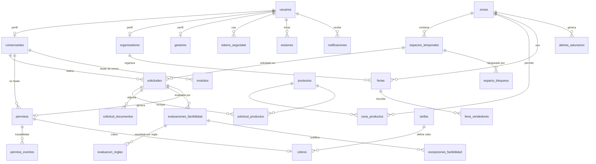

# Diseño de Base de Datos — Plataforma Web de Gestión del Espacio Público de Tuluá

**Proyecto:** Plataforma Web de Gestión del Espacio Público, Ferias Agroecológicas y Comercio Formal/Informal de Tuluá (Equipo 6)
**Motor:** PostgreSQL 18 + PostGIS 3.6 · **Codificación:** UTF8 · **Convención:** `snake_case`, español
**Scripts:** `01_creacion_bd.sql` (estructura) · `02_seed_datos_prueba.sql` (datos de prueba) · `03_sesiones.sql` (tabla de sesiones)
**Base de desarrollo verificada:** `sgp_tulua`

---

## 1. Cómo ejecutar

```powershell
# 1) Crear la base de datos
psql -U postgres -d postgres -c 'CREATE DATABASE "sgp_tulua";'

# 2) Crear la estructura (30 tablas, 17 ENUM, 3 secuencias, 28 índices,
#    6 funciones, 10 triggers y 4 vistas materializadas)
psql -U postgres -d "sgp_tulua" -f 01_creacion_bd.sql

# 3) Cargar datos de prueba (incluye 4 pruebas automáticas de reglas de negocio)
psql -U postgres -d "sgp_tulua" -f 02_seed_datos_prueba.sql

# 4) Si la base ya existía antes de esta versión, crear solo la tabla de sesiones:
psql -U postgres -d "sgp_tulua" -f 03_sesiones.sql

# Para repetir desde cero:
psql -U postgres -d postgres -c 'DROP DATABASE "sgp_tulua" WITH (FORCE);'
```

Los scripts fueron **ejecutados y verificados** sobre PostgreSQL 18.6 con PostGIS 3.6.2 (ver §11).

---

## 2. Decisiones de diseño

| Decisión | Justificación (requerimiento) |
|---|---|
| Tabla `usuarios` unificada + **perfiles 1:1 por rol** (`comerciantes`, `organizadores`, `gestores`) | Cada rol tiene campos distintos: el comerciante necesita documento, teléfono y actividad comercial (HU-01); el organizador NIT y representante (HU-07); el gestor solo correo institucional y perfil (HU-03/06). Ningún rol carga campos ajenos. |
| `citext` para el correo | Correo único sin distinción de mayúsculas (HU-01). |
| `documento` nullable con `UNIQUE` | Obligatorio solo para comerciantes (CHECK por rol); gestores y organizadores no lo requieren. |
| Geometría PostGIS SRID 4326 (WGS84) | Polígonos de zonas (HU-11) y puntos de módulos, espacios y evaluaciones (HU-13/15/25). |
| Restricciones `EXCLUDE USING gist` | Garantizan a nivel BD: sin doble asignación de espacios (HU-20), sin cruces de ferias fecha+zona (HU-22) y sin solapes de bloqueos (HU-15). |
| Parámetros del motor **versionados por filas** | HU-26: cambios sin código, con historial (valor anterior, nuevo, autor, fecha). |
| Auditoría genérica con `JSONB` (antes/después) | HU-05 (suspensiones), HU-12 (zonas), HU-26 (parámetros). |
| Trazabilidad del permiso con trigger | HU-35: suspender/revocar exige motivo (variable de sesión `app.motivo`); HU-37: eventos emitido/suspendido/revocado/vencido. |
| `verificaciones_qr` como log | HU-33: consulta pública con datos mínimos y sin información sensible; sirve para rate limiting. |
| Ciudadano **sin tabla** | El ciudadano consulta sin registrarse (HU-08/33). |
| Vistas materializadas | Dashboard en < 2 s (HU-38 a HU-44). |
| Sin campo de dirección/domicilio | El backlog no lo exige: la ubicación es geográfica (punto/polígono) y la búsqueda de calles/barrios (HU-10) se resuelve con geocodificación en la aplicación. |

**Variables de sesión de aplicación:**
- `app.actor_id` (BIGINT): usuario autenticado que realiza la acción; la usan los triggers de auditoría y trazabilidad. Se fija con `set_config('app.actor_id', '<id>', false)` o `SET app.actor_id = '<id>'`.
- `app.motivo` (TEXT): justificación obligatoria al suspender/revocar un permiso. Se fija con `SET app.motivo = '...'` antes del `UPDATE`.

---

## 3. Diagrama Entidad–Relación



---

## 4. Tipos ENUM (17)

| Tipo | Valores |
|---|---|
| `rol_usuario` | comerciante · organizador · gestor |
| `estado_usuario` | pendiente_activacion · activa · suspendida · inactiva |
| `perfil_gestor` | revisor · administrador |
| `estado_organizacion` | pendiente_validacion · activa · suspendida |
| `categoria_comercio` | formal · informal |
| `tipo_zona` | permitida · restringida · alta_congestion |
| `estado_modulo` | activo · baja |
| `estado_espacio` | disponible · bloqueado · asignado · mantenimiento |
| `estado_solicitud` | borrador · radicada · en_revision · devuelta · aprobada · rechazada · cancelada |
| `estado_documento` | pendiente · validado · observado |
| `estado_feria` | radicada · aprobada · rechazada · cancelada · realizada |
| `regla_urbanistica` | distancia_minima · producto_permitido · aforo_cuadrante |
| `resultado_factibilidad` | factible · no_factible |
| `estado_permiso` | vigente · suspendido · revocado · vencido |
| `estado_cobro` | pendiente · pagado · anulado |
| `tipo_token` | activacion · recuperacion_password · invitacion_gestor |

**Secuencias:** `seq_radicado_solicitud`, `seq_radicado_feria`, `seq_permiso` (generan `SOL-2026-#####`, `FER-2026-#####`, `PER-2026-#####`).

---

## 5. Módulo 1 — Seguridad y usuarios (HU-01 a HU-07)

### `usuarios` — Cuentas de acceso de todos los roles
| Campo | Tipo | Restricciones | Descripción |
|---|---|---|---|
| id | BIGINT | PK, IDENTITY | Identificador |
| rol | rol_usuario | NOT NULL | comerciante / organizador / gestor |
| nombre | VARCHAR(150) | NOT NULL | Nombres |
| apellido | VARCHAR(150) | | Apellidos |
| tipo_documento | VARCHAR(30) | | CC, CE, NIT… (no requerido a gestores) |
| documento | VARCHAR(30) | UNIQUE | Único; inmutable para el comerciante (HU-04) |
| telefono | VARCHAR(30) | | Contacto del comerciante |
| correo | CITEXT | NOT NULL, UNIQUE | Sirve para activación, recuperación y notificaciones |
| password_hash | VARCHAR(255) | | argon2id (hash generado por la aplicación; el seed usa literales) |
| estado | estado_usuario | NOT NULL, DEFAULT pendiente_activacion | Ciclo de vida de la cuenta |
| intentos_fallidos | SMALLINT | NOT NULL, DEFAULT 0 | HU-02: bloqueo tras 5 intentos |
| bloqueado_hasta | TIMESTAMPTZ | | Momento hasta el cual la cuenta está bloqueada |
| creado_en / actualizado_en | TIMESTAMPTZ | NOT NULL, DEFAULT now() | Marcas de tiempo (trigger) |

CHECKS: el rol comerciante exige documento + teléfono + contraseña; ninguna cuenta `activa` puede existir sin contraseña.

### `comerciantes` — Perfil comercial (1:1 con usuarios)
| Campo | Tipo | Restricciones |
|---|---|---|
| usuario_id | BIGINT | PK, FK→usuarios(id) ON DELETE CASCADE |
| actividad_comercial | VARCHAR(200) | NOT NULL |
| categoria | categoria_comercio | NOT NULL (formal/informal) |
| actualizado_en | TIMESTAMPTZ | DEFAULT now() |

### `organizadores` — Organizaciones de ferias (HU-07)
| Campo | Tipo | Restricciones |
|---|---|---|
| usuario_id | BIGINT | PK, FK→usuarios(id) ON DELETE CASCADE |
| nombre_organizacion | VARCHAR(200) | NOT NULL |
| nit | VARCHAR(20) | NOT NULL, UNIQUE |
| representante | VARCHAR(150) | NOT NULL |
| tipo_feria | VARCHAR(100) | NOT NULL |
| contacto | VARCHAR(150) | |
| estado | estado_organizacion | DEFAULT pendiente_validacion |
| validado_por / validado_en | BIGINT FK / TIMESTAMPTZ | Gestor que validó la organización |

### `gestores` — Gestores municipales (HU-03, HU-06)
| Campo | Tipo | Restricciones |
|---|---|---|
| usuario_id | BIGINT | PK, FK→usuarios(id) ON DELETE CASCADE |
| perfil | perfil_gestor | NOT NULL, DEFAULT revisor |
| creado_por | BIGINT | FK→usuarios(id) |

### `tokens_seguridad` — Tokens con vigencia (HU-01/02/06)
| Campo | Tipo | Restricciones |
|---|---|---|
| id | BIGINT | PK, IDENTITY |
| usuario_id | BIGINT | NOT NULL, FK→usuarios(id) ON DELETE CASCADE |
| tipo | tipo_token | NOT NULL (activación / recuperación / invitación) |
| token_hash | VARCHAR(255) | NOT NULL, UNIQUE — se guarda el hash, no el token |
| expira_en | TIMESTAMPTZ | NOT NULL |
| usado | BOOLEAN | NOT NULL, DEFAULT FALSE |
| creado_en | TIMESTAMPTZ | DEFAULT now() |

### `sesiones` — Sesiones autenticadas y refresh tokens (HU-02/06)
| Campo | Tipo | Restricciones |
|---|---|---|
| id | BIGINT | PK, IDENTITY |
| usuario_id | BIGINT | NOT NULL, FK→usuarios(id) ON DELETE CASCADE |
| refresh_token_hash | VARCHAR(255) | NOT NULL, UNIQUE — SHA-256 del refresh token |
| refresh_token_anterior_hash | VARCHAR(255) | Hash anterior para detectar reutilización |
| refresh_expira_en | TIMESTAMPTZ | NOT NULL — vigencia del refresh token |
| revocada_en | TIMESTAMPTZ | NULL = sesión activa; con fecha = logout/revocación |
| creada_en | TIMESTAMPTZ | DEFAULT now() |
| actualizado_en | TIMESTAMPTZ | DEFAULT now() |

El access token lleva el `id` de la sesión en el claim `sid`. El guard comprueba que
la sesión exista, no esté revocada y no haya expirado. El logout solo actualiza
`revocada_en`, por lo que la invalidación es persistente sin guardar el JWT completo.

---

## 6. Módulo 2 — Espacio público GIS (HU-08 a HU-15)

### `productos` — Catálogo maestro
| Campo | Tipo | Restricciones |
|---|---|---|
| id | BIGINT | PK, IDENTITY |
| nombre | VARCHAR(100) | NOT NULL, UNIQUE |
| activo | BOOLEAN | NOT NULL, DEFAULT TRUE |

### `zonas` — Polígonos normativos (HU-08, HU-11, HU-12)
| Campo | Tipo | Restricciones |
|---|---|---|
| id | BIGINT | PK, IDENTITY |
| nombre | VARCHAR(150) | NOT NULL |
| tipo | tipo_zona | NOT NULL |
| geometria | geometry(Polygon,4326) | NOT NULL, CHECK ST_IsValid |
| horario_inicio / horario_fin | TIME | Restricciones de horario de la zona |
| aforo_maximo | INT | CHECK > 0 — aforo por cuadrante (regla 3) |
| activa | BOOLEAN | DEFAULT TRUE — desactivar sin borrar (HU-12) |
| creado_por | BIGINT | FK→usuarios(id) |
| creado_en / actualizado_en | TIMESTAMPTZ | DEFAULT now() |

Trigger `fn_validar_zona`: rechaza geometrías inválidas y **solapes** con zonas activas (`ST_Relate '2********'`); los bordes compartidos entre zonas adyacentes sí están permitidos.

### `zona_productos` — Productos permitidos por zona (regla 2)
| Campo | Tipo | Restricciones |
|---|---|---|
| zona_id | BIGINT | PK compuesta, FK→zonas(id) ON DELETE CASCADE |
| producto_id | BIGINT | PK compuesta, FK→productos(id) |

### `modulos` — Censo de puestos formales/informales (HU-13)
| Campo | Tipo | Restricciones |
|---|---|---|
| id | BIGINT | PK, IDENTITY |
| codigo | VARCHAR(30) | NOT NULL, UNIQUE |
| ubicacion | geometry(Point,4326) | NOT NULL |
| categoria | categoria_comercio | NOT NULL |
| titular_id | BIGINT | FK→comerciantes(usuario_id), nullable |
| titular_nombre | VARCHAR(150) | Titular sin cuenta en la plataforma |
| actividad | VARCHAR(200) | NOT NULL |
| foto_url | TEXT | Foto del puesto |
| estado | estado_modulo | DEFAULT activo — la baja conserva historial |
| registrado_por | BIGINT | NOT NULL, FK→usuarios(id) |
| creado_en | TIMESTAMPTZ | DEFAULT now() |

CHECK: debe haber `titular_id` o `titular_nombre`.

### `espacios_temporales` — Catálogo de espacios asignables (HU-09, HU-15)
| Campo | Tipo | Restricciones |
|---|---|---|
| id | BIGINT | PK, IDENTITY |
| nombre | VARCHAR(150) | NOT NULL |
| zona_id | BIGINT | FK→zonas(id) |
| ubicacion | geometry(Point,4326) | NOT NULL |
| actividad_permitida | VARCHAR(100) | |
| estado | estado_espacio | DEFAULT disponible |
| creado_por | BIGINT | FK→usuarios(id) |
| creado_en | TIMESTAMPTZ | DEFAULT now() |

### `espacio_bloqueos` — Bloqueos por fechas (HU-15)
| Campo | Tipo | Restricciones |
|---|---|---|
| id | BIGINT | PK, IDENTITY |
| espacio_id | BIGINT | NOT NULL, FK ON DELETE CASCADE |
| fecha_inicio / fecha_fin | DATE | NOT NULL, CHECK fin ≥ inicio |
| motivo | VARCHAR(300) | |
| creado_por | BIGINT | NOT NULL, FK→usuarios(id) |
| creado_en | TIMESTAMPTZ | DEFAULT now() |

**EXCLUDE** (`gist`): el mismo espacio no puede tener bloqueos con fechas solapadas.

### `parametros_motor` — Parámetros versionados (HU-26, HU-29)
| Campo | Tipo | Restricciones |
|---|---|---|
| id | BIGINT | PK, IDENTITY |
| clave | VARCHAR(60) | NOT NULL — distancia_minima, aforo_cuadrante_defecto, umbral_alerta… |
| zona_id | BIGINT | FK→zonas(id) — NULL = parámetro global |
| valor | NUMERIC(10,2) | NOT NULL, CHECK ≥ 0 |
| unidad | VARCHAR(20) | metros, puestos, % |
| vigente_desde | TIMESTAMPTZ | NOT NULL, DEFAULT now() — versionado |
| creado_por | BIGINT | NOT NULL, FK→usuarios(id) |
| creado_en | TIMESTAMPTZ | DEFAULT now() |

Cada cambio es una **fila nueva**: el historial queda completo (valor anterior, nuevo, autor y fecha). El motor siempre toma la fila con `vigente_desde` más reciente.

---

## 7. Módulo 3 — Trámites (HU-16 a HU-23)

### `solicitudes` — Solicitud de uso temporal (HU-16 a HU-20)
| Campo | Tipo | Restricciones |
|---|---|---|
| id | BIGINT | PK, IDENTITY |
| numero_radicado | VARCHAR(30) | NOT NULL, UNIQUE, DEFAULT secuencia `SOL-2026-#####` |
| comerciante_id | BIGINT | NOT NULL, FK→comerciantes(usuario_id) |
| espacio_id | BIGINT | FK→espacios_temporales(id) |
| ubicacion_solicitada | geometry(Point,4326) | Ubicación exacta solicitada |
| actividad | VARCHAR(200) | NOT NULL |
| fecha_inicio / fecha_fin | DATE | NOT NULL, CHECK fin ≥ inicio |
| hora_inicio / hora_fin | TIME | NOT NULL, CHECK fin > inicio |
| estado | estado_solicitud | DEFAULT borrador (incluye borrador, HU-16) |
| revisor_id | BIGINT | FK→gestores(usuario_id) — gestor asignado |
| motivo_rechazo | TEXT | Obligatorio en la aplicación al rechazar (HU-20) |
| radicada_en / decidida_en | TIMESTAMPTZ | Para tiempos de atención (HU-44) |
| creado_en / actualizado_en | TIMESTAMPTZ | DEFAULT now() |

### `solicitud_productos` — Productos a vender
| Campo | Tipo | Restricciones |
|---|---|---|
| solicitud_id | BIGINT | PK compuesta, FK ON DELETE CASCADE |
| producto_id | BIGINT | PK compuesta, FK→productos(id) |

### `solicitud_documentos` — Documentos con verificación y corrección (HU-17, HU-19)
| Campo | Tipo | Restricciones |
|---|---|---|
| id | BIGINT | PK, IDENTITY |
| solicitud_id | BIGINT | NOT NULL, FK ON DELETE CASCADE |
| tipo_documento | VARCHAR(100) | NOT NULL — RUT, Cámara de comercio… |
| archivo_url | TEXT | NOT NULL |
| estado | estado_documento | DEFAULT pendiente (validado/observado) |
| observacion | TEXT | Comentario del revisor al observar |
| reemplaza_a | BIGINT | FK→solicitud_documentos(id) — versión corregida (HU-17) |
| cargado_en | TIMESTAMPTZ | DEFAULT now() |

### `ferias` — Ferias y eventos agroecológicos (HU-21, HU-22)
| Campo | Tipo | Restricciones |
|---|---|---|
| id | BIGINT | PK, IDENTITY |
| numero_radicado | VARCHAR(30) | NOT NULL, UNIQUE, DEFAULT `FER-2026-#####` |
| organizador_id | BIGINT | NOT NULL, FK→organizadores(usuario_id) |
| nombre | VARCHAR(200) | NOT NULL |
| tipo_feria | VARCHAR(100) | NOT NULL |
| zona_id | BIGINT | NOT NULL, FK→zonas(id) |
| fecha_inicio / fecha_fin | DATE | NOT NULL, CHECK fin ≥ inicio |
| numero_puestos | INT | NOT NULL, CHECK > 0 (se valida contra aforo, HU-21) |
| estado | estado_feria | DEFAULT radicada |
| revisor_id | BIGINT | FK→gestores(usuario_id) |
| radicada_en | TIMESTAMPTZ | DEFAULT now() |

**EXCLUDE** (`gist` + `WHERE estado IN ('radicada','aprobada')`): evita cruces de fecha y zona en el calendario (HU-22).

### `feria_productos` — Productos participantes
| Campo | Tipo | Restricciones |
|---|---|---|
| feria_id | BIGINT | PK compuesta, FK ON DELETE CASCADE |
| producto_id | BIGINT | PK compuesta, FK→productos(id) |

### `feria_vendedores` — Vendedores inscritos (HU-23)
| Campo | Tipo | Restricciones |
|---|---|---|
| id | BIGINT | PK, IDENTITY |
| feria_id | BIGINT | NOT NULL, FK ON DELETE CASCADE |
| nombre_vendedor | VARCHAR(150) | NOT NULL |
| documento | VARCHAR(30) | UNIQUE por feria (nullable) |
| producto_principal | VARCHAR(150) | |

---

## 8. Módulo 4 — Motor de factibilidad (HU-24 a HU-30)

### `evaluaciones_factibilidad` — Dictámenes
| Campo | Tipo | Restricciones |
|---|---|---|
| id | BIGINT | PK, IDENTITY |
| solicitud_id | BIGINT | FK→solicitudes(id) — NULL = pre-evaluación (HU-27) |
| comerciante_id | BIGINT | FK→comerciantes(usuario_id) — quién pidió el dictamen |
| es_simulacion | BOOLEAN | NOT NULL, DEFAULT FALSE — HU-28: no modifica datos reales |
| ubicacion | geometry(Point,4326) | NOT NULL |
| producto_id | BIGINT | FK→productos(id) |
| resultado | resultado_factibilidad | NOT NULL |
| evaluado_en | TIMESTAMPTZ | DEFAULT now() |

### `evaluacion_reglas` — Resultado por regla (HU-25)
| Campo | Tipo | Restricciones |
|---|---|---|
| id | BIGINT | PK, IDENTITY |
| evaluacion_id | BIGINT | NOT NULL, FK ON DELETE CASCADE |
| regla | regla_urbanistica | NOT NULL |
| cumple | BOOLEAN | NOT NULL |
| detalle | VARCHAR(300) | Motivo legible: «Puesto más cercano a 78.4 m…» |

### `excepciones_factibilidad` — Aprobar un «no factible» (HU-25)
| Campo | Tipo | Restricciones |
|---|---|---|
| id | BIGINT | PK, IDENTITY |
| evaluacion_id | BIGINT | NOT NULL, FK |
| justificacion | TEXT | NOT NULL |
| autorizado_por | BIGINT | NOT NULL, FK→gestores(usuario_id) |
| creado_en | TIMESTAMPTZ | DEFAULT now() |

---

## 9. Módulo 5 — Permisos y QR (HU-31 a HU-37)

### `permisos` — Permiso digital (HU-31)
| Campo | Tipo | Restricciones |
|---|---|---|
| id | BIGINT | PK, IDENTITY |
| numero | VARCHAR(30) | NOT NULL, UNIQUE, DEFAULT `PER-2026-#####` (consecutivo) |
| solicitud_id | BIGINT | NOT NULL, UNIQUE, FK→solicitudes(id) |
| titular_id | BIGINT | NOT NULL, FK→comerciantes(usuario_id) |
| espacio_id | BIGINT | FK→espacios_temporales(id) |
| ubicacion | geometry(Point,4326) | |
| categoria_autorizada | VARCHAR(200) | NOT NULL |
| fecha_inicio / fecha_fin | DATE | NOT NULL, CHECK fin ≥ inicio — vigencia |
| estado | estado_permiso | DEFAULT vigente |
| qr_token | VARCHAR(64) | NOT NULL, UNIQUE, DEFAULT `gen_random_bytes(24)` en hex — único e impredecible |
| emitido_por | BIGINT | NOT NULL, FK→gestores(usuario_id) |
| emitido_en | TIMESTAMPTZ | DEFAULT now() |
| renovado_desde | BIGINT | FK→permisos(id) — renovación enlazada (HU-34) |

**EXCLUDE** (`gist` + `WHERE estado = 'vigente'`): un mismo espacio no puede tener dos permisos vigentes con fechas solapadas (HU-20).

### `permiso_eventos` — Trazabilidad (HU-35, HU-37)
| Campo | Tipo | Restricciones |
|---|---|---|
| id | BIGINT | PK, IDENTITY |
| permiso_id | BIGINT | NOT NULL, FK ON DELETE CASCADE |
| evento | VARCHAR(30) | NOT NULL — emitido · vigente · suspendido · revocado · vencido |
| motivo | TEXT | Obligatorio al suspender/revocar (lo exige el trigger) |
| actor_id | BIGINT | FK→usuarios(id) |
| creado_en | TIMESTAMPTZ | DEFAULT now() |

### `verificaciones_qr` — Log de consulta pública (HU-33)
| Campo | Tipo | Restricciones |
|---|---|---|
| id | BIGINT | PK, IDENTITY |
| qr_token | VARCHAR(64) | NOT NULL — sin documentos ni datos sensibles |
| resultado | VARCHAR(20) | NOT NULL — valido · no_vigente · no_encontrado |
| ip | INET | |
| creado_en | TIMESTAMPTZ | DEFAULT now() (índice para rate limiting) |

---

## 10. Módulo 6 — Cobros simulados (HU-36)

### `tarifas`
| Campo | Tipo | Restricciones |
|---|---|---|
| id | BIGINT | PK, IDENTITY |
| zona_id | BIGINT | FK→zonas(id) — NULL = tarifa general |
| tipo_actividad | VARCHAR(100) | NOT NULL |
| valor | NUMERIC(12,2) | NOT NULL, CHECK ≥ 0 |
| vigente_desde | DATE | DEFAULT CURRENT_DATE |

### `cobros` — Pago SIMULADO
| Campo | Tipo | Restricciones |
|---|---|---|
| id | BIGINT | PK, IDENTITY |
| permiso_id | BIGINT | NOT NULL, UNIQUE, FK→permisos(id) |
| tarifa_id | BIGINT | FK→tarifas(id) |
| valor | NUMERIC(12,2) | NOT NULL |
| estado | estado_cobro | DEFAULT pendiente — «pagado» es simulado, sin transacciones reales |
| pagado_en | TIMESTAMPTZ | |
| recibo_url | TEXT | Recibo descargable |
| creado_en | TIMESTAMPTZ | DEFAULT now() |

---

## 11. Módulo 7 — Transversales

### `notificaciones` (HU-18, HU-34)
| Campo | Tipo | Restricciones |
|---|---|---|
| id | BIGINT | PK, IDENTITY |
| usuario_id | BIGINT | NOT NULL, FK ON DELETE CASCADE |
| tipo | VARCHAR(60) | NOT NULL — activacion · cambio_solicitud · permiso_emitido · aviso_vencimiento |
| asunto | VARCHAR(200) | NOT NULL |
| cuerpo | TEXT | |
| canal | VARCHAR(10) | DEFAULT correo (correo / app) |
| leida | BOOLEAN | DEFAULT FALSE |
| creada_en | TIMESTAMPTZ | DEFAULT now() |

### `alertas_saturacion` (HU-29)
| Campo | Tipo | Restricciones |
|---|---|---|
| id | BIGINT | PK, IDENTITY |
| zona_id | BIGINT | NOT NULL, FK→zonas(id) |
| ocupacion_pct | NUMERIC(5,2) | NOT NULL |
| umbral_pct | NUMERIC(5,2) | NOT NULL |
| generada_en | TIMESTAMPTZ | DEFAULT now() |

### `auditoria` (HU-05, HU-12, HU-26)
| Campo | Tipo | Restricciones |
|---|---|---|
| id | BIGINT | PK, IDENTITY |
| tabla | VARCHAR(60) | NOT NULL |
| registro_id | BIGINT | NOT NULL |
| accion | VARCHAR(20) | NOT NULL — insert · update · delete |
| valor_anterior | JSONB | Estado previo (en UPDATE/DELETE) |
| valor_nuevo | JSONB | Estado nuevo (en INSERT/UPDATE) |
| actor_id | BIGINT | FK→usuarios(id) — tomado de `app.actor_id` |
| creado_en | TIMESTAMPTZ | DEFAULT now() |

---

## 12. Funciones

| Función | Tipo | Descripción |
|---|---|---|
| `fn_marca_actualizacion()` | trigger | Actualiza `actualizado_en` en cada UPDATE (usuarios, comerciantes, zonas, solicitudes, sesiones). |
| `fn_auditoria()` | trigger | Vuelca cada cambio (INSERT/UPDATE/DELETE) de `usuarios`, `zonas` y `parametros_motor` a `auditoria` con valores antes/después en JSONB. |
| `fn_validar_zona()` | trigger (BEFORE) | HU-11/12: rechaza geometrías inválidas (`ST_IsValid`) y solapes con zonas activas (`ST_Relate '2********'`); permite bordes compartidos. |
| `fn_permiso_trazabilidad()` | trigger (AFTER) | HU-35/37: registra `emitido` al insertar y un evento por cada cambio de estado; **exige motivo** (`app.motivo`) para `suspendido`/`revocado`, si no lanza excepción. |
| `fn_evaluar_factibilidad(ubicacion, producto_id)` | plpgsql STABLE | **Motor de reglas (HU-25)**: devuelve una fila por regla (`distancia_minima`, `producto_permitido`, `aforo_cuadrante`) con `cumple` y `detalle`. La distancia se calcula en metros con cast `geography`; el aforo y los productos se validan contra la zona que contiene el punto usando los parámetros vigentes de `parametros_motor`. |
| `fn_buscar_alternativas(ubicacion, producto_id, radio_m)` | sql STABLE | HU-30: espacios `disponibles` dentro del radio (default 500 m) que cumplen **todas** las reglas del motor, ordenados por distancia. |

## 13. Triggers

| Trigger | Tabla | Función |
|---|---|---|
| trg_usuarios_marca, trg_comerciantes_marca, trg_zonas_marca, trg_solicitudes_marca, trg_sesiones_marca | 5 tablas | fn_marca_actualizacion (BEFORE UPDATE) |
| trg_usuarios_auditoria, trg_zonas_auditoria, trg_parametros_auditoria | 3 tablas | fn_auditoria (AFTER INSERT/UPDATE/DELETE) |
| trg_zonas_validar | zonas | fn_validar_zona (BEFORE INSERT/UPDATE) |
| trg_permisos_traza | permisos | fn_permiso_trazabilidad (AFTER INSERT/UPDATE) |

---

## 14. Vistas materializadas (Dashboard · HU-38 a HU-44)

| Vista | Descripción |
|---|---|
| `mv_ocupacion_zona` | Por zona: puestos activos, formales, informales, aforo y % de ocupación (HU-38/39). |
| `mv_recaudacion` | Recaudo simulado por mes, zona y actividad (HU-41). |
| `mv_saturacion` | Puntos por módulo activo con su zona para el mapa de calor (HU-40). |
| `mv_tiempos_atencion` | Solicitudes por estado y tiempo promedio de resolución (HU-44). |

Refresco (job programado en producción): `REFRESH MATERIALIZED VIEW CONCURRENTLY mv_ocupacion_zona;` (cada vista tiene índice único para permitirlo).

---

## 15. Reglas de negocio garantizadas por la BD (verificadas)

| Regla (HU) | Mecanismo | Resultado de la prueba |
|---|---|---|
| Correo y documento únicos (HU-01) | `UNIQUE` con `citext` | ✔ INSERT con correo duplicado → rechazado |
| Campos obligatorios del comerciante (HU-01) | `CHECK` por rol | ✔ |
| Geometría válida y sin solapes de zonas (HU-11/12) | `CHECK ST_IsValid` + trigger `fn_validar_zona` | ✔ zona solapada → rechazada |
| Bloqueos de espacio sin solaparse (HU-15) | `EXCLUDE USING gist` | ✔ |
| Un espacio no se asigna dos veces en fechas solapadas (HU-20) | `EXCLUDE` en `permisos` WHERE vigente | ✔ permiso solapado → rechazado |
| Calendario de ferias sin cruces fecha+zona (HU-22) | `EXCLUDE` en `ferias` WHERE radicada/aprobada | ✔ |
| Parámetros no negativos y versionados (HU-26) | `CHECK valor >= 0` + historial por filas | ✔ |
| QR único e impredecible (HU-31) | `qr_token UNIQUE DEFAULT gen_random_bytes(24)` | ✔ |
| Suspender/revocar exige motivo (HU-35) | Trigger `fn_permiso_trazabilidad` | ✔ revocación sin `app.motivo` → rechazada |
| Trazabilidad del permiso (HU-37) | `permiso_eventos` automático | ✔ emitido → suspendido → vigente registrados |

Las cuatro pruebas negativas se ejecutan dentro de `02_seed_datos_prueba.sql` y emiten `NOTICE OK (...)` al pasar.

---

## 16. Índices

- **B-tree:** usuarios(rol, estado), tokens(usuario, tipo), sesiones(usuario, revocada_en), sesiones(refresh_token_anterior_hash), modulos(estado, titular), espacios(zona), parametros(clave, vigente_desc), solicitudes(comerciante, estado, espacio+fecha), documentos(solicitud), ferias(zona), evaluaciones(solicitud), permisos(titular, estado), eventos(permiso, creado_en), verificaciones(creado_en), cobros(estado), notificaciones(usuario, leida), auditoria(tabla+registro, fecha).
- **GIST espaciales:** `zonas(geometria)`, `modulos(ubicacion)`, `espacios_temporales(ubicacion)`, `evaluaciones_factibilidad(ubicacion)`.
- **Únicos (para REFRESH CONCURRENTLY):** uno por vista materializada.

---

## 17. Datos de prueba incluidos en el seed

| Datos | Contenido |
|---|---|
| Usuarios (8) | 2 gestores (admin / revisor), 4 comerciantes (uno pendiente de activación), 2 organizadores (uno pendiente de validación) |
| Contraseñas (argon2id) | `admin@tulua.gov.co` y `revisor@tulua.gov.co` → `Admin1234` · comerciantes → `Comerciante123` · organizadores → `Organizador123` |
| Zonas (4) | Centro–Calle 30 (permitida, aforo 40), Plaza Boyacá (alta congestión, aforo 15), Entorno Hospital (restringida, aforo 5), Parque La Guadua (permitida, aforo 25) — polígonos alrededor del centro de Tuluá |
| Productos (6) | Frutas frescas, Verduras, Artesanías, Comidas rápidas, Ropa y calzado, Plantas ornamentales |
| Módulos (6) | 2 con titular registrado, 4 con titular por nombre; mezcla formal/informal |
| Espacios (4) | 3 disponibles, 1 bloqueado con bloqueo 25–31 oct 2026 |
| Parámetros | distancia_minima = 5 m · aforo_cuadrante_defecto = 40 · umbral_alerta = 80 % |
| Solicitudes (4) | 1 aprobada, 1 radicada, 1 rechazada (con motivo), 1 borrador; 5 documentos (incluye corrección versionada con `reemplaza_a`) |
| Ferias (2) | 1 aprobada (Dic 2026, Parque La Guadua, 20 puestos, 3 vendedores), 1 radicada (Ene 2027) |
| Evaluaciones (2) | 1 factible (solicitud aprobada), 1 no factible por producto no permitido (pre-evaluación simulada) con excepción justificada |
| Permiso (1) | PER-2026-00001 vigente con QR; ciclo de vida demostrado: emitido → suspendido → vigente; cobro de 50 000 pagado (simulado) con recibo |
| Otros | 4 notificaciones, 2 verificaciones QR (válida y no encontrada), 1 alerta de saturación (Plaza Boyacá 86,67 % > 80 % de umbral relativo) |

## 18. Verificación realizada (PostgreSQL 18.6 + PostGIS 3.6.2, BD `SPG-Prueba`)

```
=== 1) Motor de reglas: punto en Centro-Calle 30 con Frutas frescas (HU-25) ===
 distancia_minima   | t | Puesto activo más cercano a 78.4 m; mínimo exigido: 5 m
 producto_permitido | t | Producto permitido en la zona Centro - Calle 30
 aforo_cuadrante    | t | 2 puestos activos de 40 permitidos en Centro - Calle 30

=== 2) Mismo punto con Comidas rápidas → falla la regla de producto ===
 producto_permitido | f | Producto NO permitido en la zona Centro - Calle 30

=== 3) Alternativas desde Plaza Boyacá para Frutas frescas (HU-30) ===
 Espacio móvil Calle 30 - B  | Centro - Calle 30 | 333.3 m
 Espacio móvil Calle 30 - A  | Centro - Calle 30 | 445.4 m
 Kiosco Parque La Guadua     | Parque La Guadua  | 464.5 m

=== 4) Dashboard mv_ocupacion_zona (HU-38/39) ===
 Centro - Calle 30 | permitida       | 2 activos | 1 formal | 1 informal | aforo 40 | 5.00 %
 Plaza Boyacá      | alta_congestion | 2 activos | 1 formal | 1 informal | aforo 15 | 13.33 %
 Entorno Hospital  | restringida     | 0 activos |    0     |     0      | aforo  5 | 0.00 %
 Parque La Guadua  | permitida       | 2 activos | 1 formal | 1 informal | aforo 25 | 8.00 %

=== 5) Recaudo simulado mv_recaudacion (HU-41) ===
 2026-10 | Centro - Calle 30 | Venta de frutas y verduras | 50000.00

=== 6) Trazabilidad del permiso (HU-37) ===
 emitido    | (sin motivo)
 suspendido | Reporte de inspección: horario excedido el 2026-11-15
 vigente     | Levantado el reporte de inspección por la Secretaría de Gobierno

=== 7) Pruebas automáticas del seed (reglas de negocio) ===
 NOTICE: OK (HU-11/12): la BD rechazó insertar una zona solapada
 NOTICE: OK (HU-20): la BD rechazó asignar el mismo espacio en fechas solapadas
 NOTICE: OK (HU-35): la BD rechazó revocar un permiso sin motivo justificado
 NOTICE: OK (HU-01): la BD rechazó un correo duplicado
```

---

## 19. Matriz de trazabilidad HU ↔ tablas

| Historias | Tablas / objetos |
|---|---|
| HU-01 a HU-07 | usuarios, comerciantes, organizadores, gestores, tokens_seguridad, sesiones |
| HU-08 a HU-15 | zonas, zona_productos, productos, modulos, espacios_temporales, espacio_bloqueos |
| HU-16 a HU-23 | solicitudes, solicitud_productos, solicitud_documentos, ferias, feria_productos, feria_vendedores |
| HU-24 a HU-30 | parametros_motor, evaluaciones_factibilidad, evaluacion_reglas, excepciones_factibilidad, alertas_saturacion + fn_evaluar_factibilidad + fn_buscar_alternativas |
| HU-31 a HU-37 | permisos, permiso_eventos, verificaciones_qr |
| HU-36 | tarifas, cobros |
| HU-18, HU-34 | notificaciones |
| HU-38 a HU-44 | mv_ocupacion_zona, mv_recaudacion, mv_saturacion, mv_tiempos_atencion |
| Transversal | auditoria, notificaciones, índices GIST |

> **Nota:** `spatial_ref_sys` (tabla adicional en `public`) es creada automáticamente por PostGIS; no forma parte del diseño de negocio.
